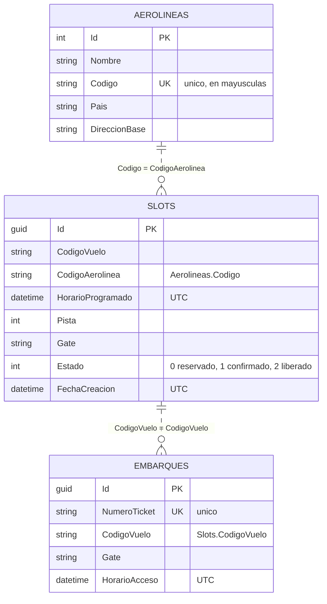

# PortHub API

API REST del aeropuerto para el Trabajo Integrador de Programación 2. Administra aerolíneas, slots de horario (pista + gate) y el control de embarque de pasajeros. Se integra con la API de la aerolínea (**AeroLink**) para validar tickets y avisar cuando un slot se confirma.

- **Stack:** .NET 10, ASP.NET Core Web API, Entity Framework Core 10 + SQLite, Swagger (Swashbuckle).
- **Estructura:** `Models/` (entidades), `DTOs/`, `Context/` (DbContext), `Interfaces/`, `Services/` (lógica), `Controllers/`, `Filters/` (`[ApiKey]`), `Middlewares/` (errores), `Migrations/`, `wwwroot/` (panel web).

---

## Cómo levantarla

1. Copiar `.env.example` como `.env` y completar los valores:

   | Variable | Qué es |
   |---|---|
   | `ApiKey` | La clave que tienen que mandar quienes llaman a PortHub |
   | `AeroLinkApi__BaseUrl` | URL base de la API de AeroLink, **terminada en `/`** (ej. `http://localhost:5099/`) |
   | `AeroLinkApi__ApiKey` | La clave que nos dio AeroLink |

2. Si no existe `porthub.db`, crear la base: `dotnet ef database update`
3. Correr: `dotnet run`

| Qué | Dirección |
|---|---|
| API | `http://localhost:5157/api/...` |
| Swagger | `http://localhost:5157/swagger` |
| Panel web | `http://localhost:5157/index.html` |


---

## Reglas generales

**Autenticación.** Todos los endpoints exigen el header:

```
Authorization: ApiKey <clave>
```

Si falta o es incorrecta, la respuesta es `401`:

```json
{
  "code": "UNAUTHORIZED",
  "message": "API Key faltante o inválida.",
  "details": "Debe enviar el header Authorization: ApiKey <clave>."
}
```

**Formato.** Cuerpos en JSON con `Content-Type: application/json`, nombres en camelCase. Las fechas van en ISO 8601 y en **UTC** (con `Z` al final), por ejemplo `2026-12-01T14:00:00Z`.

**Errores.** Todas las respuestas de error tienen la misma forma `{ code, message, details }`:

| Status | `code` | Cuándo |
|---|---|---|
| 400 | `VALIDATION_ERROR` | Falta un dato obligatorio, tiene formato inválido o el JSON está mal armado. `details` lista cada campo con su problema |
| 401 | `UNAUTHORIZED` | Falta la API Key o es incorrecta |
| 404 | `NOT_FOUND` | La ruta no existe |
| 405 | `METHOD_NOT_ALLOWED` | La ruta existe pero no con ese método |
| 415 | `UNSUPPORTED_MEDIA_TYPE` | El cuerpo no se mandó como JSON |
| 409 | `CONFLICT` | La base rechazó el dato por duplicado (respaldo de las validaciones) |
| 500 | `INTERNAL_SERVER_ERROR` | Error inesperado. El detalle queda solo en el log del servidor |

Ejemplo de `400`:

```json
{
  "code": "VALIDATION_ERROR",
  "message": "Los datos enviados no son válidos.",
  "details": "Pista: La pista debe ser un número entre 1 y 10."
}
```

Cada endpoint tiene además sus propios errores, listados abajo.

---

## Resumen de endpoints

| Método | URL | Qué hace |
|---|---|---|
| GET | `/api/aerolineas` | Lista las aerolíneas |
| GET | `/api/aerolineas/{id}` | Trae una aerolínea |
| POST | `/api/aerolineas` | Registra una aerolínea |
| PUT | `/api/aerolineas/{id}` | Modifica una aerolínea |
| GET | `/api/slots/disponibilidad?pista=&horario=` | Dice si una pista está libre en un horario |
| POST | `/api/slots/solicitudes` | Reserva un slot para un vuelo |
| POST | `/api/slots/cancelaciones` | Libera el slot activo de un vuelo |
| PATCH | `/api/slots/{slotId}/confirmacion` | Confirma un slot y le avisa a AeroLink |
| GET | `/api/slots?codigoVuelo=` | Trae el slot de un vuelo |
| POST | `/api/embarques` | Registra el acceso de un pasajero (valida el ticket con AeroLink) |
| GET | `/api/embarques?gate=` | Trazabilidad de accesos |
| GET | `/api/vuelos` | Vuelos con slot activo, con gate, pista y estado |

---

## Aerolíneas

### GET `/api/aerolineas`

Lista todas las aerolíneas registradas.

**Respuesta `200`:**

```json
[
  {
    "id": 5,
    "nombre": "Aerolineas Argentinas",
    "codigo": "ARG",
    "pais": "Argentina",
    "direccionBase": "http://localhost:5099"
  }
]
```

### GET `/api/aerolineas/{id}`

| Parámetro | Dónde | Tipo | Obligatorio |
|---|---|---|---|
| `id` | ruta | número | sí |

**Respuesta `200`:** una aerolínea, con la misma forma que en el listado.

| Status | `code` | Cuándo |
|---|---|---|
| 404 | `AEROLINEA_NOT_FOUND` | No existe una aerolínea con ese id |

### POST `/api/aerolineas`

Registra una aerolínea. El código se guarda en mayúsculas (`arg` queda `ARG`). Una aerolínea tiene que estar registrada para poder pedir slots.

**Cuerpo:**

| Campo | Tipo | Reglas |
|---|---|---|
| `nombre` | texto | obligatorio |
| `codigo` | texto | obligatorio, de 2 a 10 caracteres, único |
| `pais` | texto | obligatorio |
| `direccionBase` | texto | obligatorio (URL base de la API de la aerolínea) |

```json
{
  "nombre": "Aerolineas Argentinas",
  "codigo": "ARG",
  "pais": "Argentina",
  "direccionBase": "http://localhost:5099"
}
```

**Respuesta `201`** (con header `Location: /api/Aerolineas/5`):

```json
{
  "id": 5,
  "nombre": "Aerolineas Argentinas",
  "codigo": "ARG",
  "pais": "Argentina",
  "direccionBase": "http://localhost:5099"
}
```

| Status | `code` | Cuándo |
|---|---|---|
| 400 | `VALIDATION_ERROR` | Falta un campo o el código no tiene entre 2 y 10 caracteres |
| 409 | `AEROLINEA_DUPLICADA` | Ya existe una aerolínea con ese código (sin importar mayúsculas) |

### PUT `/api/aerolineas/{id}`

Modifica nombre, país y dirección. El código no se puede cambiar.

**Cuerpo:**

```json
{
  "nombre": "Aerolineas Argentinas S.A.",
  "pais": "Argentina",
  "direccionBase": "http://localhost:5099"
}
```

**Respuesta `204`:** sin cuerpo.

| Status | `code` | Cuándo |
|---|---|---|
| 400 | `VALIDATION_ERROR` | Falta un campo |
| 404 | `AEROLINEA_NOT_FOUND` | No existe una aerolínea con ese id |

---

## Slots

Un slot reserva **una pista y un gate durante 60 minutos** para un vuelo. Por ejemplo, un slot a las 14:00 ocupa la pista y el gate de 14:00 a 15:00, así que otro vuelo puede usarlos a las 15:00 pero no a las 14:30.

**Estados:**

```
reservado ──(PATCH confirmacion)──> confirmado
    │                                    │
    └────────(POST cancelaciones)────────┴──> liberado
```

Un slot `liberado` deja de ocupar la pista y el gate. Cada vuelo puede tener un solo slot activo (`reservado` o `confirmado`) a la vez.

**Forma de un slot** (la usan varios endpoints):

```json
{
  "slotId": "3fa85f64-5717-4562-b3fc-2c963f66afa6",
  "codigoVuelo": "AR100",
  "codigoAerolinea": "ARG",
  "horarioProgramado": "2026-12-01T14:00:00Z",
  "pista": 1,
  "gate": "G01",
  "estado": "reservado"
}
```

### GET `/api/slots/disponibilidad`

Dice si una pista está libre en un horario, teniendo en cuenta la ventana de 60 minutos.

| Parámetro | Dónde | Tipo | Obligatorio |
|---|---|---|---|
| `pista` | query | número de 1 a 10 | sí |
| `horario` | query | fecha UTC | sí |

Ejemplo: `GET /api/slots/disponibilidad?pista=1&horario=2026-12-01T14:30:00Z`

**Respuesta `200`:**

```json
{
  "disponible": false,
  "pista": 1,
  "horario": "2026-12-01T14:30:00Z"
}
```

| Status | `code` | Cuándo |
|---|---|---|
| 400 | `VALIDATION_ERROR` | Falta `pista` o `horario`, o la pista no está entre 1 y 10 |

### POST `/api/slots/solicitudes`

Reserva un slot. El código de aerolínea y el gate se guardan en mayúsculas.

**Cuerpo:**

| Campo | Tipo | Reglas |
|---|---|---|
| `codigoVuelo` | texto | obligatorio, solo letras y números, de 3 a 10 caracteres |
| `codigoAerolinea` | texto | obligatorio, de 2 a 10 caracteres, tiene que estar registrada en `/api/aerolineas` |
| `horarioProgramado` | fecha UTC | obligatorio, tiene que ser a futuro |
| `pista` | número | obligatorio, de 1 a 10 |
| `gate` | texto | obligatorio, hasta 10 caracteres |

```json
{
  "codigoVuelo": "AR100",
  "codigoAerolinea": "ARG",
  "horarioProgramado": "2026-12-01T14:00:00Z",
  "pista": 1,
  "gate": "G01"
}
```

**Respuesta `201`** (con header `Location: /api/Slots?codigoVuelo=AR100`): el slot creado, con `"estado": "reservado"`.

| Status | `code` | Cuándo |
|---|---|---|
| 400 | `VALIDATION_ERROR` | Falta un campo o no cumple las reglas de la tabla |
| 409 | `SLOT_OCCUPIED` | La pista o el gate ya tienen otro vuelo a menos de 60 minutos |
| 409 | `VUELO_CON_SLOT_ACTIVO` | El vuelo ya tiene un slot reservado o confirmado |
| 422 | `AEROLINEA_NO_EXISTE` | La aerolínea no está registrada |
| 422 | `HORARIO_PASADO` | El horario ya pasó |

Ejemplo de `409`:

```json
{
  "code": "SLOT_OCCUPIED",
  "message": "La pista o gate no se encuentra disponible para el horario solicitado.",
  "details": "Pista 1 ocupada en el intervalo de 14:00 a 15:00 hs (UTC) por el vuelo AR100."
}
```

### POST `/api/slots/cancelaciones`

Libera el slot activo de un vuelo.

**Cuerpo:**

```json
{ "codigoVuelo": "AR100" }
```

**Respuesta `200`:**

```json
{
  "mensaje": "Slot liberado correctamente",
  "codigoVuelo": "AR100",
  "estado": "liberado"
}
```

| Status | `code` | Cuándo |
|---|---|---|
| 400 | `VALIDATION_ERROR` | Falta `codigoVuelo` |
| 404 | `SLOT_NOT_FOUND` | El vuelo no tiene un slot activo |

### PATCH `/api/slots/{slotId}/confirmacion`

Confirma un slot reservado y le avisa a AeroLink. Funciona en este orden:

1. Guarda el slot como `confirmado`.
2. Llama a AeroLink: `POST {AeroLinkApi__BaseUrl}api/aeropuerto/callbacks/slots`, con el slot en el cuerpo. AeroLink consulta `GET /api/slots?codigoVuelo=` y tiene que ver `confirmado`.
3. Si AeroLink rechaza el aviso o no responde en 5 segundos, el slot **vuelve a `reservado`**, para que los dos sistemas no queden distintos.

| Parámetro | Dónde | Tipo | Obligatorio |
|---|---|---|---|
| `slotId` | ruta | GUID | sí |

No lleva cuerpo.

**Respuesta `200`:** el slot, con `"estado": "confirmado"`.

| Status | `code` | Cuándo |
|---|---|---|
| 404 | `SLOT_NOT_FOUND` | No existe un slot con ese id |
| 409 | `SLOT_LIBERADO` | El slot ya fue liberado |
| 409 | `SLOT_YA_CONFIRMADO` | El slot ya estaba confirmado |
| 422 | `AEROLINK_RECHAZO_CONFIRMACION` | AeroLink respondió 404 o 409 (por ejemplo, vuelo cancelado). El slot sigue reservado |
| 503 | `AEROLINK_NO_DISPONIBLE` | AeroLink no respondió, tardó más de 5 segundos o respondió otro error. El slot sigue reservado |

### GET `/api/slots?codigoVuelo=`

Trae el slot más reciente de un vuelo, en cualquier estado. Es el endpoint que usa AeroLink para consultar el estado.

| Parámetro | Dónde | Tipo | Obligatorio |
|---|---|---|---|
| `codigoVuelo` | query | texto | sí |

**Respuesta `200`:** el slot.

| Status | `code` | Cuándo |
|---|---|---|
| 400 | `VALIDATION_ERROR` | Falta `codigoVuelo` |
| 404 | `SLOT_NOT_FOUND` | El vuelo no tiene ningún slot |

---

## Embarques

### POST `/api/embarques`

Registra el acceso de un pasajero en un gate. Funciona en este orden:

1. Revisa que el ticket no se haya usado antes.
2. Valida el ticket con AeroLink: `GET {AeroLinkApi__BaseUrl}api/tickets/{numeroTicket}/validacion`.
3. Revisa que el vuelo del ticket tenga un slot activo.
4. Revisa que el pasajero esté en el gate de ese slot.

**Cuerpo:**

| Campo | Tipo | Reglas |
|---|---|---|
| `numeroTicket` | texto | obligatorio, solo letras, números y guiones, de 3 a 40 caracteres |
| `gate` | texto | obligatorio, hasta 10 caracteres |

```json
{
  "numeroTicket": "TCK-001",
  "gate": "G01"
}
```

**Respuesta `201`:**

```json
{
  "id": "8d0f6a2e-4c1b-4f7e-9a3d-2b5e6c7d8f90",
  "numeroTicket": "TCK-001",
  "codigoVuelo": "AR1234",
  "gate": "G01",
  "horarioAcceso": "2026-12-01T13:40:00Z"
}
```

| Status | `code` | Cuándo |
|---|---|---|
| 400 | `VALIDATION_ERROR` | Falta un campo o el ticket tiene caracteres no permitidos |
| 409 | `TICKET_YA_UTILIZADO` | El ticket ya se registró antes |
| 422 | `TICKET_INVALIDO` | AeroLink dice que el ticket no es válido o no lo conoce |
| 422 | `VUELO_SIN_SLOT` | El vuelo del ticket no tiene un slot activo |
| 422 | `GATE_INCORRECTO` | El vuelo embarca por otro gate |
| 503 | `AEROLINK_NO_DISPONIBLE` | AeroLink no respondió o respondió con error. El pasajero no se registró |

### GET `/api/embarques`

Trazabilidad: lista los accesos registrados, del más reciente al más viejo.

| Parámetro | Dónde | Tipo | Obligatorio |
|---|---|---|---|
| `gate` | query | texto (ej. `G01`) | no. Si no se manda, trae todos |

**Respuesta `200`:** una lista de embarques, con la misma forma que la respuesta del POST.

---

## Vuelos

### GET `/api/vuelos`

Lista los vuelos que tienen un slot activo (`reservado` o `confirmado`), con su gate, pista y estado.

**Respuesta `200`:**

```json
[
  {
    "codigoVuelo": "AR100",
    "codigoAerolinea": "ARG",
    "horarioProgramado": "2026-12-01T14:00:00Z",
    "pistaAsignada": 1,
    "gateAsignado": "G01",
    "estadoSlot": "reservado"
  }
]
```

---

## Integración con AeroLink

| Sentido | Llamada | Para qué |
|---|---|---|
| PortHub → AeroLink | `GET api/tickets/{codigoTicket}/validacion` | Validar un ticket en el embarque. Respuesta esperada: `{ esValido, codigoTicket, codigoVuelo, pasajero }` |
| PortHub → AeroLink | `POST api/aeropuerto/callbacks/slots` | Avisar que un slot se confirmó. Cuerpo: el slot (`slotId`, `codigoVuelo`, `estado`, ...) |
| AeroLink → PortHub | `POST /api/slots/solicitudes`, `POST /api/slots/cancelaciones`, `GET /api/slots?codigoVuelo=`, `GET /api/slots/disponibilidad` | Pedir, cancelar y consultar slots |

Las dos direcciones usan el header `Authorization: ApiKey <clave>`. Cada grupo le pasa su clave al otro por privado. El cliente hacia AeroLink espera como máximo 5 segundos.

---

## Modelo de la base de datos

Base SQLite (`porthub.db`) creada con migraciones de Entity Framework Core.



**Tablas**

| Tabla | Clave primaria | Índices únicos | Para qué |
|---|---|---|---|
| `Aerolineas` | `Id` (autoincremental) | `Codigo` | Aerolíneas que operan en el aeropuerto |
| `Slots` | `Id` (GUID) | (`Pista`, `HorarioProgramado`) solo entre slots no liberados (`Estado <> 2`) | Reserva de pista y gate por vuelo |
| `Embarques` | `Id` (GUID) | `NumeroTicket` | Registro de cada pasajero que pasó por el control |

**Relaciones.** Las relaciones se hacen por código, no por id. Por eso en el diagrama están en línea punteada:

- Una **aerolínea** tiene muchos **slots**: `Slots.CodigoAerolinea` = `Aerolineas.Codigo`. Al pedir un slot se comprueba que la aerolínea exista.
- Un **slot** tiene muchos **embarques**: `Embarques.CodigoVuelo` = `Slots.CodigoVuelo`. Al registrar un embarque se comprueba que el vuelo tenga un slot activo y que el gate coincida.

**Reglas que cuida la base o el servicio**

- Dos slots activos no pueden compartir pista ni gate a menos de 60 minutos de distancia (servicio). El índice único (`Pista`, `HorarioProgramado`) lo respalda en la base para el mismo horario exacto.
- Un vuelo tiene como máximo un slot activo (servicio).
- Un ticket se registra una sola vez (índice único).